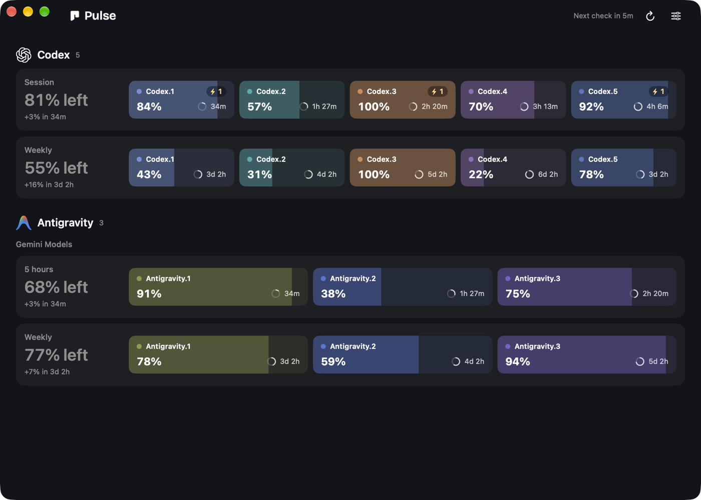

#  Pulse

A small macOS dashboard and menu-bar companion for the subscription accounts you use in T3 Code.

[Download Pulse](https://github.com/djalilmsk/Pulse/releases/latest) · macOS 14 or later · Apple silicon

- Compare session and weekly quotas across accounts, with reset times and availability per provider.
- Open the compact menu-bar summary or the full dashboard. Choose the provider order and whether Pulse appears in the Dock.
- Use banked Codex reset credits from account details, with confirmation before redemption.

## How it works

Pulse discovers enabled T3 Code accounts, including Codex, Claude, Cursor, OpenCode, Muse Code, Pi, Antigravity, and Grok. Other configured providers can also appear. Pulse displays the quota windows T3 Code publishes in its local cache. Accounts without quota data show unavailable readings. Pulse uses the installed `codex` and `agy` CLIs for direct quota refreshes. It also tries `muse usage --json` for the default local Muse Code account, with T3 Code as a fallback. For other enabled providers, Pulse asks the running local T3 Code server to refresh at startup, every five minutes, and on manual refresh. This path requires the T3 CLI and a running local T3 Code server. Pulse can still display cached readings when the server is unavailable. Antigravity’s CLI is launched with a temporary copy of the selected local T3 sign-in. Pulse makes no direct provider HTTP requests. This is an unofficial integration, and provider or CLI changes can affect availability.

## Build

With Xcode Command Line Tools installed, run `./scripts/build.sh` and open `dist/Pulse.app`. The release ZIP and local builds use ad-hoc signing.

Provider marks are included with the [T3 Code MIT notice](Resources/T3-Tools-MIT.txt). Bricolage Grotesque is distributed under the [SIL Open Font License](Resources/BricolageGrotesque-OFL.txt).
