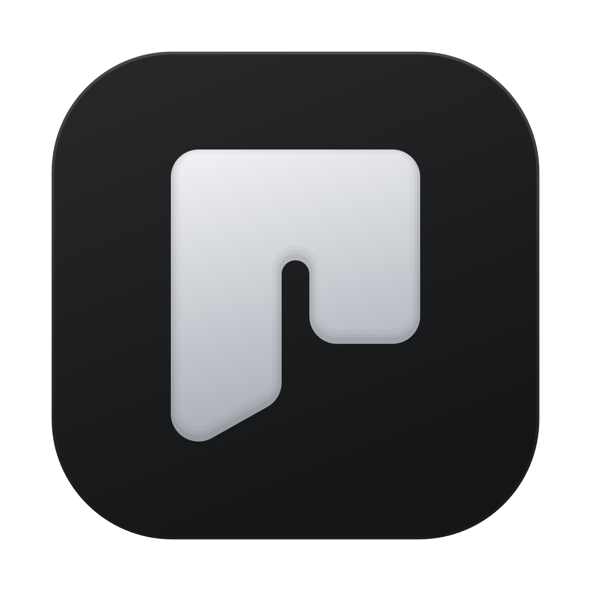

#  Pulse

A small macOS dashboard and menu-bar companion for the subscription accounts you use in T3 Code.

[Download Pulse](https://github.com/djalilmsk/Pulse/releases/latest) · macOS 14 or later · Apple silicon

- Compare session and weekly quotas across accounts, with reset times and availability per provider.
- Open the compact menu-bar summary or the full dashboard. Choose the provider order and whether Pulse appears in the Dock.
- Use banked Codex reset credits from account details, with confirmation before redemption.

## How it works

Pulse reads the local T3 Code provider inventory and quota cache. For live readings it uses the installed `codex` and `agy` CLIs. Antigravity’s CLI is launched with a temporary copy of the selected local T3 sign-in. Pulse makes no direct provider HTTP requests. This is an unofficial integration, and provider or CLI changes can affect availability.

## Build

With Xcode Command Line Tools installed, run `./scripts/build.sh` and open `dist/Pulse.app`. The release ZIP and local builds use ad-hoc signing.

Provider marks are included with the [T3 Code MIT notice](Resources/T3-Tools-MIT.txt). Bricolage Grotesque is distributed under the [SIL Open Font License](Resources/BricolageGrotesque-OFL.txt).
